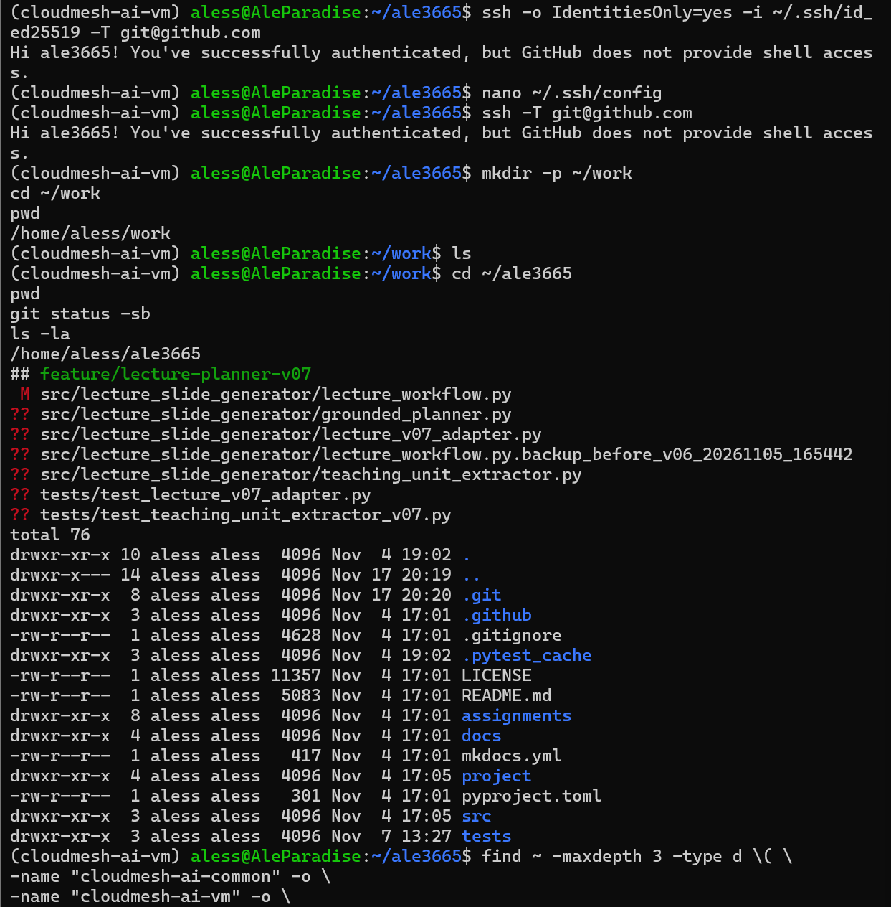
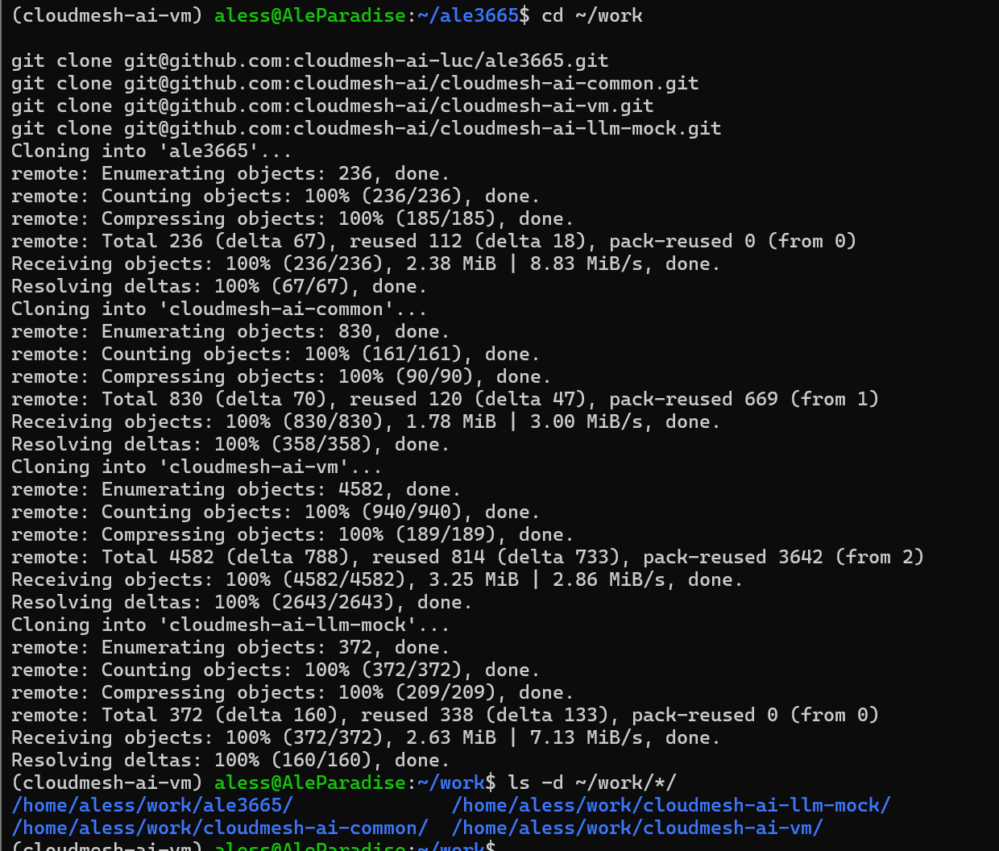
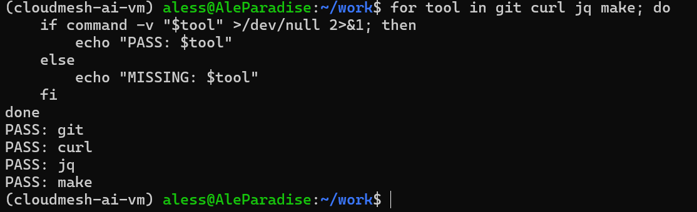
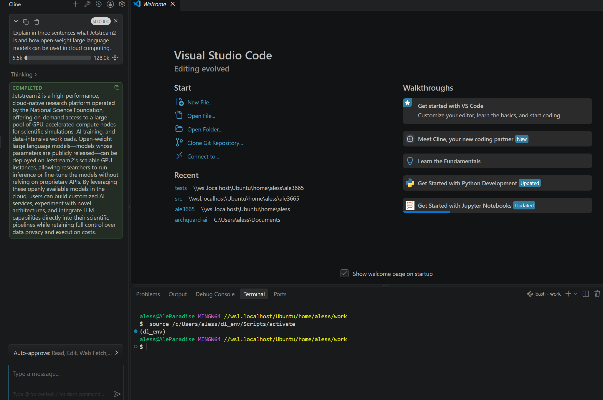

# Peer-Assisted DevOps Demonstration

**Course:** Cloud Computing, DevOps, and AI  
**Instructor:** Professor Gregor von Laszewski  
**Student:** Alessandra Vellucci Solari  
**GitHub ID:** `ale3665`  
**Repository:** [cloudmesh-ai-luc/ale3665](https://github.com/cloudmesh-ai-luc/ale3665)  
**Peer Collaborator:** AnnieWall ([course repository](https://github.com/cloudmesh-ai-luc/AnieWall))  
**Date of Demonstration:** November 17, 2026  
**Status:** Demonstration completed; screenshot evidence to be organized.

## 1. Objective

I participated in a peer-assisted DevOps demonstration with AnnieWall to review foundational workflows used throughout the Cloud Computing, DevOps, and AI course. The session centered on SSH authentication, Git Bash, Git and GitHub repository operations, Visual Studio Code, and the use of Cline with a language model.

The objective was to reinforce understanding of these tools and how they support practical work with the shared Cloudmesh development ecosystem.

## 2. Development Environment

The session covered the following tools and environments:

- Windows and Git Bash
- Visual Studio Code
- Git and GitHub
- SSH keys and SSH-agent
- Cloudmesh course repositories
- Cline inside VS Code
- An AI model configured for development assistance

My own coursework additionally uses Ubuntu WSL2 and the `cloudmesh-ai-vm` Python virtual environment.

## 3. Demonstration Activities

### 3.1 SSH and Authentication

We reviewed how SSH identities support secure GitHub access. The explanation distinguished private and public SSH keys, fingerprints, and identities registered with the SSH agent.

Commands reviewed included:

```bash
ssh-add -l
ssh -T git@github.com
```

### 3.2 Git Bash and Repository Management

We reviewed navigating project folders, identifying the active Git branch, checking working-tree changes, inspecting remotes, and opening repositories in VS Code.

```bash
git status -sb
git remote -v
code .
```

We also discussed the relationship between local repositories, upstream projects, commits, branches, and pull requests.

### 3.3 Cline and AI-Assisted Development

We reviewed the integration of Cline with Visual Studio Code and how a configured LLM can support code explanation, debugging, and development planning.

The discussion emphasized verifying model suggestions through source-code inspection and actual test execution instead of treating AI-generated answers as automatically correct.

### 3.4 Practical Verification

The session combined explanations with demonstrations of development workflows and relevant commands. Screenshots of individual command results and supporting activities will be added as evidence after selection and review.

## 4. Screenshot Evidence

The following five screenshots document the peer-assisted DevOps demonstration completed with AnnieWall on November 17, 2026. The evidence covers GitHub SSH authentication, class workspace preparation, Bash utilities, Visual Studio Code configuration, and Cline integration with an LLM.

### Figure 1 — SSH Authentication

This screenshot documents the SSH authentication workflow used to establish secure access to GitHub repositories.

The activity covered SSH key configuration and verification of GitHub authentication from the terminal.



### Figure 2 — Class WORK Directory

This screenshot documents the creation and organization of the `~/work` directory required for the Cloudmesh coursework.

The activity focused on Linux directory management and organizing the required class repositories.



### Figure 3 — Bash Utilities

This screenshot documents the verification of the required Bash utilities used throughout the Cloudmesh development workflow.

The utilities include Git, curl, jq, and make, which support repository management, HTTP requests, JSON processing, and automated build tasks.



### Figure 4 — Launching Visual Studio Code and Configuring Git Bash

This screenshot documents launching Visual Studio Code directly from the terminal using `code .` and configuring Git Bash as the default terminal profile.

The activity demonstrated how to connect a command-line workflow with the development environment.

.png)

### Figure 5 — LLM and Cline Integration in VS Code

This screenshot documents configuring Cline inside Visual Studio Code to communicate with an LLM using an OpenAI-compatible API.

The activity demonstrated how AI-assisted development tools can be integrated into an existing programming environment.



### Evidence Summary

| Figure | Demonstration Activity | Screenshot |
|---|---|---|
| 1 | SSH authentication | Evidence 1 |
| 2 | Cloudmesh `~/work` directory | Evidence 2 |
| 3 | Bash utilities | Evidence 3 |
| 4 | VS Code and Git Bash configuration | Evidence 4 |
| 5 | LLM and Cline integration | Evidence 5 |

**Evidence Status:** Five screenshots prepared to document the practical activities completed during the peer-assisted demonstration on November 17, 2026.

## 5. Learning Outcomes

The session reinforced my understanding of:

- Secure SSH authentication, identities, and key management.
- Git Bash navigation and common shell workflows.
- Git branches, local changes, remotes, commits, and pull requests.
- Working with VS Code and Cline during development.
- Critically checking LLM-generated guidance against source code and test results.
- Preparing supporting evidence for course submission.

## 6. Security Considerations

Any screenshots or logs submitted as evidence should exclude SSH private keys, passphrases, API keys, passwords, cloud credentials, and other sensitive information.

The demonstration did not require destructive actions on cloud infrastructure.

## 7. Conclusion

The peer-assisted session with AnnieWall provided an opportunity to review and reinforce the foundational skills needed for Cloudmesh coursework and development. It connected command-line authentication, source control, IDE integration, and AI-assisted workflows into one practical learning activity.

I completed the collaborative demonstration on November 17, 2026. Supporting screenshots will be added once selected and verified.

**Final Verification Status:** Demonstration completed; screenshot evidence pending.

**Related peer report:** [AnnieWall — DevOps Peer-Assisted Demo](https://github.com/cloudmesh-ai-luc/AnieWall/blob/main/assignments/reports/DevOps%20Peer-Assisted%20Demo)
